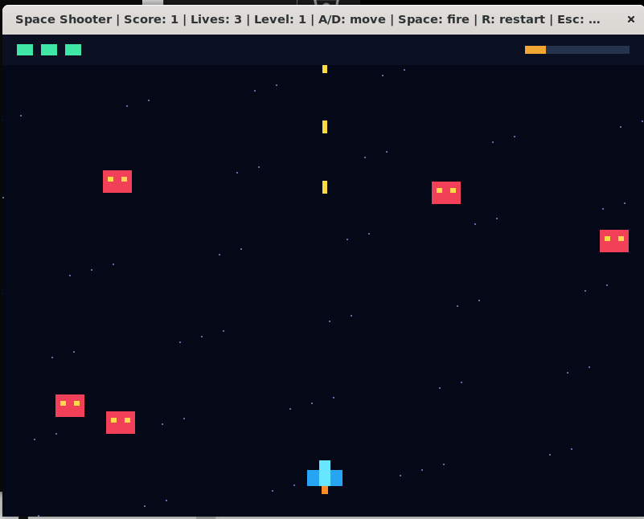

# Space Shooter

A small 2D arcade game written in **C++17 and OpenGL 3.3 Core**. Move your
ship, shoot falling enemies, and survive as their speed increases.

The game features a moving starfield, a blue ship, red enemies, life
indicators, and a score display. All game logic and both shaders are in
[`main.cpp`](main.cpp). Graphics use **VAO, VBO, EBO, and `glDrawElements`**.
No game engine, textures, or separate shader files are required.

## Preview



[Watch the gameplay video (MP4)](results/gameplay.mp4)

## Controls and rules

| Input | Action |
| --- | --- |
| **A / D** or **Left / Right** | Move the ship |
| **Hold Space** | Fire |
| **R** | Restart |
| **Escape** | Quit |

- Start with **3 lives** and face **5 enemies** that respawn above the screen.
- Destroy an enemy to earn one point.
- An enemy touching your ship or escaping below the screen costs one life.
- Every five points increases enemy speed, up to a maximum of 300 units/second.
- At zero lives, gameplay freezes and a red X appears. Press R to play again.
- Score, lives, level, and controls are shown in the window title. Green bars
  show lives; the yellow bar tracks progress within each group of five hits.

## Requirements

- A C++17 compiler: GCC, Clang, or MSVC.
- OpenGL **3.3 Core or newer**, supported by your graphics driver.
- GLFW development files, or CMake to download and build GLFW.
- A graphical desktop. Ubuntu through **WSL 2 needs WSLg** for the window.
- CMake **3.20+** if using the CMake build instructions.

GLAD is included in `external/glad`. The repository is self-contained and
does not require the original course repository.

## Get the project

```bash
git clone https://github.com/alooxaa/space_shooter.git
cd space_shooter
```

Alternatively, choose **Code → Download ZIP** on GitHub, extract it, and
open a terminal in the extracted folder containing `main.cpp`.

## Ubuntu / WSL: quick start

Run these commands **inside Ubuntu**, not Windows PowerShell:

```bash
sudo apt update
sudo apt install build-essential libglfw3-dev libgl1-mesa-dev
bash run.sh
```

`run.sh` rebuilds the game and then starts it. After editing and saving the
code, close the running game and run `bash run.sh` again.

Build without opening a window:

```bash
bash run.sh --build-only
```

Start an already built game:

```bash
./build/space_shooter
```

## Ubuntu: CMake build

```bash
sudo apt install cmake build-essential libglfw3-dev libgl1-mesa-dev
cmake -S . -B build-cmake -DCMAKE_BUILD_TYPE=Release
cmake --build build-cmake --parallel
./build-cmake/bin/space_shooter
```

CMake uses an installed GLFW package when available. Otherwise, it downloads
GLFW 3.4; that first configuration needs internet access. On Ubuntu, building
GLFW from source also requires `sudo apt install xorg-dev` for its X11 backend.
See [GLFW's build guide](https://www.glfw.org/docs/3.4/compile_guide.html).

## Windows: CMake build

Install **Visual Studio Build Tools** or Visual Studio with the
**Desktop development with C++** workload. Include the MSVC compiler,
Windows SDK, and **C++ CMake tools for Windows**.
[Microsoft's setup instructions](https://code.visualstudio.com/docs/cpp/config-msvc)

Open **Developer PowerShell for Visual Studio**, change to the downloaded
project folder, then run:

```powershell
cmake -S . -B build
cmake --build build --config Release --target space_shooter
.\build\bin\Release\space_shooter.exe
```

With a single-configuration generator such as Ninja, the executable is
`build\bin\space_shooter.exe` instead. CMake downloads GLFW if it is not
already installed, so the first build may need internet access.

## Project files

```text
space_shooter/
├── main.cpp                 Game logic, shaders, and rendering
├── CMakeLists.txt           Standalone and course-project build
├── run.sh                   Ubuntu/WSL rebuild-and-run script
├── external/glad/           Bundled OpenGL function loader and license
├── results/                 Screenshot (PNG) and gameplay video (MP4)
├── THIRD_PARTY_NOTICES.md   Dependency notices
└── README.md
```

## How the graphics work

The VBO stores four corners of a unit square. The EBO stores six indices
for two triangles and four extra indices for the game-over cross. The VAO
describes how OpenGL reads this data.

The vertex shader scales and moves the square using a `rect` uniform and
converts game coordinates into clip coordinates. The fragment shader uses
a `color` uniform to color the shape. Every ship part, bullet, star, and
indicator reuses this geometry and shader program.

Collision detection checks overlapping rectangles. Movement uses elapsed
frame time, capped at 0.02 seconds to limit large jumps after a stalled frame;
at very low frame rates, the simulation slows down.

To customize the game, search `main.cpp` for `enemies[5]`, `bullets[160]`,
`lives = 3`, and `cooldown = 0.01f`. Lives are assigned both in the initial
state and in `restartGame()`; update the restart value when changing them.

## Troubleshooting

| Problem | What to check |
| --- | --- |
| `g++: command not found` | Install `build-essential` in Ubuntu. |
| `GLFW/glfw3.h: No such file` or `cannot find -lglfw` | Install `libglfw3-dev`, or use CMake to build GLFW. |
| `glad/gl.h: No such file` | Keep `external/glad` in the project and build with `run.sh` or CMake. |
| `cmake` is not recognized | Install CMake; on Windows use the Visual Studio developer terminal. |
| Window creation or display error | Use a graphical desktop/WSLg and a driver supporting OpenGL 3.3 Core. |
| Changes do not appear | Save the source, close the game, and rebuild with `bash run.sh` or CMake. |

For WSL graphics setup, see [Microsoft's WSL GUI guide](https://learn.microsoft.com/en-us/windows/wsl/tutorials/gui-apps).

Ubuntu/WSL is the development test environment. Native Windows instructions
are provided, but a Windows build has not been verified in this environment.
Third-party notices are in [THIRD_PARTY_NOTICES.md](THIRD_PARTY_NOTICES.md).
